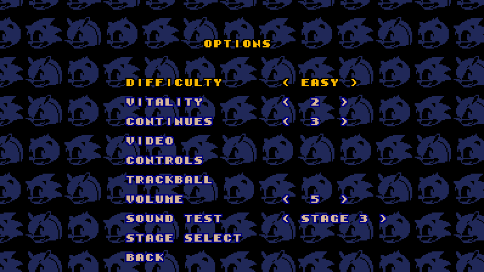

# SegaSonic The Hedgehog — native port

Sega's 1993 arcade game *SegaSonic The Hedgehog* (Sega System 32) as a native game for Windows, Linux and
macOS, and, with its assets made on your computer, for the Nintendo Switch, Android and Anbernic's handhelds:
not an emulator, but the game's own program decompiled into C
([segasonic-decomp](https://github.com/cheviman/segasonic-decomp)) and built for each system, with a console
version made for playing at home beside the arcade one.

**This repository and its downloads contain no game data.** As with
[n64decomp/sm64](https://github.com/n64decomp/sm64), you bring your own ROM set: the first time the game
runs, it takes its graphics, sound and data out of your MAME `sonic.zip` and never needs it again. No
executable carries the ROM or anything from it.

<p align="center">
  
  
  
  
  
  
</p>
<p align="center"><sub>The console version with WIDE on, as its window shows it
(<code>tools/make_screenshots.py</code> makes them from scripted runs).</sub></p>

## Playing

### Download

The [latest release](https://github.com/cheviman/segasonic-port/releases/latest) has a package for
**Windows** (x64), **Linux** (x64) and **macOS** (Apple silicon and Intel, one app), and one for **Anbernic's
H700 handhelds**; every change to the
code is built the same way by [GitHub Actions](https://github.com/cheviman/segasonic-port/actions), whose
runs keep the packages as artifacts. Unpack it anywhere:

| Package | What is in it |
|---|---|
| Windows `segasonic-windows-x64.zip` | `SegaSonic.exe` (the console version), `SegaSonic Arcade.exe` (the arcade one), and the pictures the window draws its letters and controls with; `SegaSonic NSP.exe` and `SegaSonic APK.exe`, which make the Switch's and Android's games, with the game's Switch and Android builds beside them (`switch/`, `android/`) |
| Linux `segasonic-linux-x64.tar.gz` | `SegaSonic`, `SegaSonic Arcade`, the same pictures, and `SegaSonic NSP` and `SegaSonic APK` with `switch/` and `android/` |
| macOS `segasonic-macos-universal.zip` | `SegaSonic.app` and `SegaSonic Arcade.app`, and `SegaSonic NSP` and `SegaSonic APK` with `switch/` and `android/` |
| Anbernic `segasonic-anbernic.zip` | `PORTS/`, the folder for the handheld's `Roms/`: `SegaSonic.sh` and the game in `segasonic/`, where your `segasonic.assets` goes (below) |

Each has a `README.txt` that says which game is which, and the licenses of what the executables contain
(`LICENSE.txt`, `licenses/`). SDL2 and the C runtime
are built into the executables: nothing else to install. The macOS apps are not signed by a developer: the
first time, open one with right click → Open (on macOS 15 and later, try to open it, then System Settings →
Privacy & Security → Open Anyway).

### The first run

The game needs the arcade's ROM set: MAME's `sonic` (*SegaSonic The Hedgehog*, Japan, rev. C), the
`sonic.zip` of 18 files. Put it beside the game (the `.app` on macOS) before starting it, or start the
game and drop it on the window that asks for it. The game checks every file by its CRC32, takes out what
it uses into `segasonic.assets` (in the folder where it keeps its files, below) and starts; from then on
it loads that pack and never opens the ROM set again. The pack is made from your ROM: it is yours, not
one to share.

### The console version: SegaSonic

`SegaSonic` is the arcade game made for playing at home, in a layer of its own over the same program
(`console/`); the arcade game underneath runs as it does on the board.

- **No coins.** Power-on goes to the SEGA logo (with a jingle of its own) and the title: PRESS START opens
  a menu, START GAME, TIME ATTACK, OPTIONS, EXIT. A game has CONTINUES (3 at first) instead of credits, or
  plays free.
- **Up to three players**, as the arcade's 3-player cabinet: each with their own keys and game controller.
  A player joins at player select, or whenever their start prompt is up.
- **WIDE** (OPTIONS → VIDEO): a 16:9 picture. The stages, the title, the ranking and player select are drawn
  wider; past where the board's camera ever looks, the stage's map goes on as its rows and walls do. The
  scenes, drawn for 4:3, show between bars.
- **OPTIONS**: DIFFICULTY and VITALITY (the operator's settings), CONTINUES, VIDEO (WINDOW size, FULL
  SCREEN, PIXELS: sharp, smooth, soft or a CRT's scanlines and mask, WIDE), CONTROLS, VOLUME, SOUND TEST
  (the song picked becomes the title's music) and STAGE SELECT.
- **TIME ATTACK**: a level, or the whole game from Eggman's place on the map. The clock runs through stages,
  scenes and continues, with a split at the end of each level; BEST TIMES and BEST RUN keep the records.
- **STAGE SELECT**: the island map with every level open; the levels cleared in this session's games show
  in the map's cleared colours.
- **In English**: the how to play and Eggman's lines are in the game's own English text boxes, which its
  program never shows (the Japanese board shows Japanese ones).
- **Pause**: start (or back) in a stage pauses the game and its scripted scenes.
- **CONTROLS**: every action's keys and game controller button, for each player, on screen with Kenney's
  Input Prompts.

### Controls

The console version's actions, by default (OPTIONS → CONTROLS changes them; a player's game controller is
the one plugged in in their turn):

| Action | Player 1 | Player 2 | Player 3 | Game controller |
|---|---|---|---|---|
| Move (the trackball) | arrows or WASD, or the mouse (after a click) | I J K L | keypad 8 4 5 6 | pad or left stick |
| Jump, spin | Z or Space, or the left mouse button | U | keypad 0 | A |
| Start, pause | Enter or P | 2 | 3 | Start |
| Accept (menus) | Enter, Z or Space | U | keypad 0 | A |
| Back (menus), pause | Escape or Backspace | O | keypad . | B |

The mouse is a pointer until a click in the window makes it player 1's trackball (the pointer hides); a
pause (Escape) gives the pointer back, and a click takes it again. Alt+F4 or Cmd+Q close the game at any
time; the title's menu has EXIT.

On Windows each mouse (a trackball too) is a trackball of its own: the first one to move is player 1's, and
the next ones to press a button are players 2 and 3, each with its own left button (the button) and right
button (which holds the ball). `separate = no` under `[mouse]` in `sonic.ini` makes the mouse player 1's alone,
as on the other systems.

The window, in both versions: F11 or Alt+Enter full screen, F3 smooth or sharp pixels, F4 whether the
mouse's ball rolls on when the mouse stops, F5 and F6 the mouse slower or faster.

### The arcade version: SegaSonic Arcade

`SegaSonic Arcade` is the arcade game as the board runs it, matching MAME frame by frame: put a coin in (5), then
start (1). Player 1's controls:

| Control | Keys |
|---|---|
| Trackball | the mouse, or the arrow keys |
| Button | left mouse button, Z or space |
| Coins 1-3, starts 1-3 | 5, 6, 7 and 1, 2, 3 |
| Service, test | 9 and F2 (in the operator's menu, 9 moves the cursor and F2 picks) |
| Quit | Escape |

The mouse is always the trackball here, and turns as the arcade's does: the ball turns with the mouse and, when the mouse stops
or is lifted, rolls on and slows down; the right button holds it. Each game controller is a player: the
left stick is the trackball, A the button, Start the start and Back a coin.

### Where the game keeps its files

Beside the executable on Windows; `~/.local/share/SegaSonic` on Linux; `~/Library/Application
Support/SegaSonic` on macOS:

| File | What it holds |
|---|---|
| `segasonic.assets` | the assets pack the first run made from your ROM set |
| `segasonic.ini`, `sonic.ini` | SegaSonic's and SegaSonic Arcade's window settings, with what each one does (the game reads the file again whenever it is saved while it runs) |
| `controls.ini` | the console version's keys and buttons, a section a player |
| `segasonic.times` | TIME ATTACK's best times and best run |
| `segasonic.eeprom`, `sonic.eeprom` | each one's game settings and bookkeeping, as the board's EEPROM keeps them |

### Nintendo Switch

The console version as an `.nsp`, made on your computer by `SegaSonic NSP` from your `sonic.zip` and your
console's keys, to install as any homebrew `.nsp` (a console with Atmosphère and signature patches). The
Switch makes nothing from the ROM set: the `.nsp` carries your assets, so it is yours alone, **never share
it**.

1. Put your `sonic.zip` and your console's `prod.keys` beside `SegaSonic NSP` (it comes in the computer's
   package, with the folder `switch` beside it: the game's Switch build). The keys may also be in `.switch`
   in your user folder.
2. Open `SegaSonic NSP` (a double click). Its window shows what it found; drop on it whatever is somewhere
   else: `prod.keys`, `sonic.zip`, or a 256 x 256 JPEG for your own HOME menu icon (named `icon.jpg`
   beside the tool, both tools take it by themselves). **Choose the output folder** if `SegaSonic.nsp`
   should not go beside the tool.
3. **Make SegaSonic.nsp** (or Enter). Copy it to the Switch's SD card and install it with Tinfoil, DBI,
   Goldleaf or another installer.

From a command line: `SegaSonic NSP --keys prod.keys --rom sonic.zip --icon my_icon.jpg --out SegaSonic.nsp`.
On the Switch the picture is 16:9 and the controls fixed (the d-pad or the left stick move, A jumps and
picks, B goes back in the menus, + starts and pauses); HOME leaves the game. More in
[ports/switch/README.md](ports/switch/README.md).

### Android

The console version as an APK, made on your computer by `SegaSonic APK` from your `sonic.zip`, for Android 7
or later. The phone makes nothing from the ROM set: the APK carries your assets, so it is yours alone,
**never share it**.

1. Put your `sonic.zip` beside `SegaSonic APK` (it comes in the computer's package, with the folder
   `android` beside it: the game's Android build).
2. Open `SegaSonic APK` (a double click). Drop `sonic.zip` on its window if it is somewhere else, and a
   square PNG or JPEG if you want your own launcher icon (the `icon.jpg` beside the tool, if there is one, is
   taken by itself). **Choose the output folder** if `SegaSonic.apk` should not go beside the tool.
3. **Make SegaSonic.apk** (or Enter). Copy it to the phone and open it there (Android asks once to allow
   installing from that app), or install it from the computer with `adb install -r SegaSonic.apk`.

From a command line: `SegaSonic APK --rom sonic.zip --icon my_icon.png --out SegaSonic.apk`.

The first time, the tool makes a signing key of yours and keeps it in your own folder (`%APPDATA%\SegaSonic`
on Windows, `~/.config/SegaSonic` on Linux, `~/Library/Application Support/SegaSonic` on macOS). Keep it:
Android installs a new APK over the last one, keeping your settings and records, only when both have the same
key.

On the phone the picture is 16:9. The touch screen has its controls: a stick where your left thumb lands, A to
jump and pick, START to start and pause; a Bluetooth or USB game controller works too (the d-pad or the left
stick, A, B back in the menus, Start), and the touch controls hide while it is used. Android's back goes back
in the menus. The pause has CONTINUE and EXIT. More in [ports/android/README.md](ports/android/README.md).

### Anbernic handhelds

The console version for the stock firmware of Anbernic's H700 handhelds (played on the RG40XX H; the RG35XX
Plus, RG40XX V and RG CubeXX should run it too), in `segasonic-anbernic.zip`. The handheld makes nothing from
the ROM set: the game's folder takes the assets pack your computer made.

1. Play `SegaSonic` on your computer once with your `sonic.zip`: its first run writes `segasonic.assets`
   (where the game keeps its files, above).
2. Put `segasonic.assets` in the package's `PORTS/segasonic/`, beside `SegaSonic`. It is yours alone:
   **never share it**.
3. Copy `PORTS` into `Roms/` on the handheld's card: SegaSonic is in the firmware's PORTS.

On the handheld the picture is 4:3 at 60 frames a second; the d-pad or the left stick move, A jumps and picks,
B goes back in the menus, START starts and pauses, MENU leaves the game and the volume keys turn its volume;
OPTIONS → CONTROLS changes the buttons. More in [ports/anbernic/README.md](ports/anbernic/README.md).

## Building

Requirements: CMake 3.20 or newer, a C11 / C++17 compiler (Visual Studio Build Tools on Windows, GCC or
Clang elsewhere), Python 3.10 or newer, and SDL2: on Windows `SDL2-devel-2.x.x-VC.zip` from
[SDL's releases](https://github.com/libsdl-org/SDL/releases) unpacked into `build/downloads/sdl2/` (or
`SDL2_DIR` pointed at it), on Linux the system's (`libsdl2-dev`), on macOS Homebrew's (`sdl2`). With
`-DSEGASONIC_STATIC_SDL2=ON` the build takes SDL2's source instead and builds it into the executables, as
the downloads are.

1. Put your MAME `sonic.zip`, or the files inside it, in `rom/`, and check it:

   ```bash
   python tools/verify_rom.py
   ```

2. Build. With `rom/` there, the build also makes `build/bin/segasonic.assets`; without it, only the
   executables, which make the pack on their first run:

   ```bash
   cmake -S . -B build/cmake
   ```

   ```bash
   cmake --build build/cmake --config Release
   ```

3. Play: `build/bin/SegaSonic` (the console version) or `build/bin/SegaSonic Arcade` (the arcade one);
   `.app`s on macOS.

The build also makes the game without a window, for scripted runs (`sonic_game_headless`, and
`segasonic_console_headless`, whose `--actions` presses the console's actions), and the tools that check
the game against MAME's (`s32ref`; `-DSEGASONIC_REFERENCE_TOOLS=OFF` leaves them out), and the tools that
make the game devices' games, `SegaSonic NSP` and `SegaSonic APK`. The game devices' own builds are in their
READMEs: [the Switch](ports/switch/README.md) (devkitPro), [Android](ports/android/README.md) (the NDK and
the SDK's tools) and [Anbernic's handhelds](ports/anbernic/README.md) (Zig).

## How it is checked

The arcade version is the decompilation unchanged. Its 98 scenarios (`tests/controls/`: the attract mode,
games for one to three players, every stage, the ending, the test mode) run on the game and on the
original program on MAME's V60 core, and the two match frame by frame, the board's memories, the picture
and the sound, on Windows (MSVC) and on Linux (GCC and Clang):

```bash
python tools/check_scenarios.py --video --sound
```

The console version changes the game only where `console/replaced.txt` says: its own versions of those
functions, in `console/`, while the arcade build keeps the originals. It runs the same on every system,
frame by frame: `segasonic_console_headless --actions` drives its menus as the window's keys do, and
`python tools/make_screenshots.py` remakes the pictures at the top of this page from such runs, and
`--check` says whether they are still those.

The game devices draw the board's video on several threads, a band of rows each
(`runtime/src/workers.c`): the frames are the same, which the scenarios show with the threads on
(`SEGASONIC_VIDEO_WORKERS=2`).

## This repository and segasonic-decomp

[segasonic-decomp](https://github.com/cheviman/segasonic-decomp) is the decompilation: the faithful
reference, with the decompiler, the names and evidence (`symbols.txt`), the assets' formats, the board,
video and sound libraries and the tools that check them, and its README explains how to read and change
the C. This repository merges it and adds the port; what belongs to the decompilation changes there first
and comes here by merge:

```
console/                the console version: what it changes in the game (replaced.txt) and how
                        (console.c), and what is next (PLAN.md)
ports/sdl2/             the window: the picture, sound and controls on SDL2, the settings, the first run
                        (first_run.c), the console's actions and their keys (actions.c, controls.ini),
                        the pictures of Kenney's (prompts/, font/), the executables' icon (icon/,
                        tools/make_icon.py)
ports/headless/         the game without a window, for checks and screenshots
ports/switch/           the Nintendo Switch: its build (switch.cmake) and SegaSonic NSP, the tool that
                        makes the .nsp on the player's computer (nsp/; tools/check_nsp.py checks one)
ports/android/          Android: its build with the NDK, without Gradle (android.cmake), the touch
                        controls (ports/sdl2/touch.c) and SegaSonic APK, the tool that makes the APK on the
                        player's computer (apk/)
ports/anbernic/         Anbernic's H700 handhelds: the build with Zig (zig_aarch64.cmake), the launcher
runtime/src/workers.c   the video's rows on several threads, as the game devices draw it
tools/make_screenshots.py  the screenshots above
.github/workflows/      the builds and packages for Windows, Linux and macOS, with the Switch's and
                        Android's builds in them, and Anbernic's package
```

## Credits

- The game: *SegaSonic The Hedgehog*, SEGA, 1993.
- [Kenney](https://kenney.nl): Input Prompts Pixel, the keys and buttons of CONTROLS
  (`ports/sdl2/prompts/`), and Kenney Mini (Kenney Fonts), the letters of the first run's window
  (`ports/sdl2/font/`); both CC0.
- [MAME](https://www.mamedev.org): the reference the game is checked against (its V60 and Z80 cores, its
  System 32 video and RF5C68), and [ymfm](https://github.com/aaronsgiles/ymfm), the YM3438's.
- [SDL](https://www.libsdl.org) (zlib license), built into the executables.

## Legal

- This project is licensed under the BSD 3-Clause License; see `LICENSE`.
- The C in `src/` is the game's program decompiled into a new form: logic only, with names and
  comments written for this project. No ROM contents (graphics, sound, data tables, level data) and no
  extracted assets are distributed by this project; they come from your own ROM. The screenshots in
  `docs/screenshots/` show the game running from this code.
- `runtime/`, `tools/v60/disassembler.py` and `tools/z80/disassembler.py` follow the behavior of MAME
  source files and, for the YM3438, of ymfm, and `tools/reference/mame/` holds copies of MAME files. Those
  are BSD-3-Clause; see `tools/reference/mame/LICENSE`. `tools/reference/ymfm/` holds a copy of ymfm
  (BSD-3-Clause; see its `LICENSE`).
- Kenney's pictures and font are CC0; see the `License.txt` beside each.
- SegaSonic The Hedgehog is a trademark of SEGA. This project is not affiliated with or endorsed by SEGA.
